# ByteOS 0.2 "Sprinkles"

ByteOS is a tiny 64-bit bare-metal operating system that you can read end to
end. It boots from its own hand-built El Torito ISO or from its own MBR,
enters long mode without GRUB and without a libc, and gives you a VGA text
console, a persistent ByteFS disk, accounts and login, a guided disk
installer, a fastfetch-style system summary, and two desktops: the classic
text-mode ByteDesktop and a 640x480 graphical ByteWin 95 with a mouse,
windows, icons, and a small command prompt.

Source and releases: **https://github.com/withdrawment/byteos**

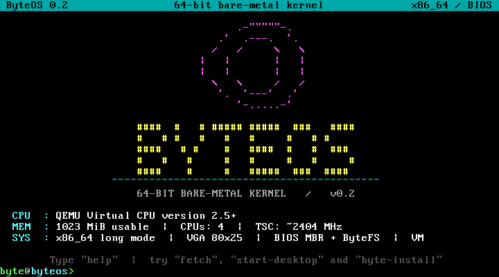

## What is new in 0.2

- **ByteFS** - a small flat filesystem on an ATA PIO disk: 32 directory
  entries, full paths, no journal and no permissions. Files survive a reboot.
- **`byte-install`** - an archinstall-style guided installer that writes an
  MBR, stage 2, the kernel, a ByteFS partition, the bundled website, and your
  account database to a raw disk.
- **Accounts and login** - a user account and a root account. Passwords are
  stored as FNV-1a hashes. `su`, `passwd`, `whoami`, and an installed-disk
  login screen are included.
- **`fetch`** - a fastfetch-style system screen with live CPU, memory,
  uptime, disk, boot mode, and account data, plus shaded 3D torus ASCII art.
- **ByteDesktop** - a full-screen text-mode desktop with Files, Browser,
  Editor, Terminal, Fetch, and Donut.
- **ByteWin 95** - a real 640x480 VGA graphics desktop with 16 colours, a
  mouse cursor, icons, draggable windows with minimize/maximize controls, a
  Start menu, a taskbar, Notepad, My Computer, System Properties, About, a
  native Fetch window, a starfield screensaver, and a graphical command
  prompt.
- **Desktop chooser** - `start-desktop` asks which desktop to run each time;
  `start-desktop classic` and `start-desktop win95` skip the prompt.
- **Linux-style shell** - `pwd`, `cd`, `mkdir`, `rmdir`, `touch`, `rm`,
  `ls`/`dir`, `lsblk`, `df`, `free`, `uname`, `date`, `uptime`, `hostname`,
  and `echo` join the existing ByteOS commands.
- **Local HTML browser** - reads pages from ByteFS or from the pages embedded
  in the ISO. It renders headings, paragraphs, lists, links, tables, and
  preformatted text. The project website ships inside the OS.
- **HTML editor** - cursor editing with insert, delete, and save to ByteFS.
- **Bundled website** - `www/index.html`, `docs.html`, `install.html`, and
  `manual.html`, readable offline in the ByteOS browser.

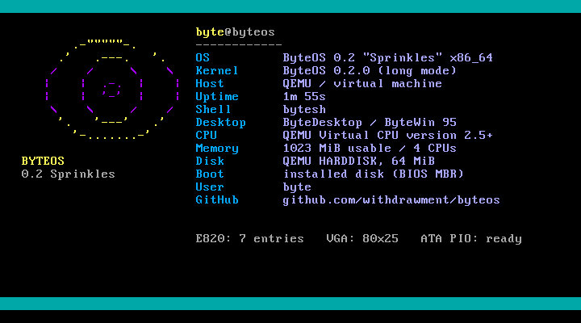

## Try the live ISO

```powershell
.\build.ps1
.\run.ps1
```

`build.ps1` produces `ByteOS.iso` in the project root. `run.ps1` starts it in
QEMU with 1 GiB of RAM and four CPU cores. You can also download a release ISO
from https://github.com/withdrawment/byteos/releases.

The ISO is a legacy BIOS / CSM boot image. It works in QEMU, VirtualBox (BIOS
mode), VMware, on a burned CD/DVD, and from Ventoy. A UEFI-only machine needs
CSM enabled; native UEFI boot is not implemented.

The live environment is read-only. The disk is untouched until you run the
installer. Useful first commands:

```text
fetch
specs
start-desktop
donut
```

## Guided installation

The supported installer is `byte-install`. It asks for a disk, a username, a
user password, a root password, a hostname, and a final confirmation. It then
writes the complete system to the selected **ATA/IDE** disk.

> **This erases the entire selected disk.** Use a spare disk, a USB stick, or
> a virtual disk. Never select the disk that holds your current OS.

The quickest way to try an installation is QEMU:

```powershell
qemu-img create -f raw byteos-disk.img 64M
qemu-system-x86_64 -m 1024 -smp 4 `
  -cdrom ByteOS.iso `
  -drive file=byteos-disk.img,format=raw,if=ide `
  -boot d
```

At the `byteos>` prompt:

```text
byte-install
```

A typical session:

```text
Installation disk [1-1]: 1
Username: byte
Password: ****
Repeat password: ****
Root password: ****
Repeat root password: ****
Hostname [byteos]: byteos
Type INSTALL to erase QEMU HARDDISK: INSTALL
```

When the installer finishes, press **R** to reboot, remove the ISO from the
virtual machine, and boot the disk:

```powershell
qemu-system-x86_64 -m 1024 -smp 4 `
  -drive file=byteos-disk.img,format=raw,if=ide `
  -boot c
```

ByteOS then shows a login screen. Sign in with the user you created. The root
account is available from the shell with `su`.

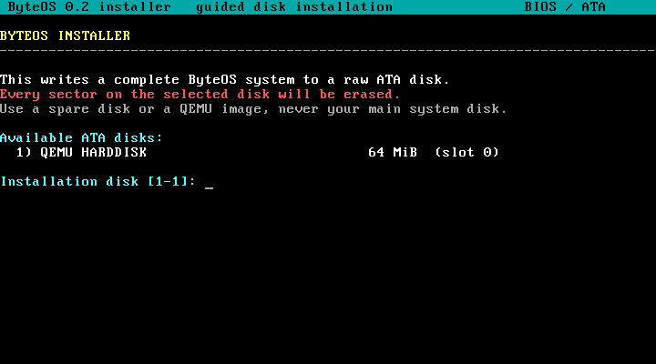

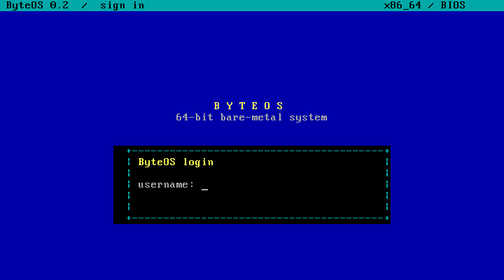

## Manual installation

The full step-by-step guide lives at
[`website/manual.html`](website/manual.html), and it is also readable inside
ByteOS at `byteos://www/manual.html`. It covers building the ISO, creating a
disk image, installing with QEMU, writing the finished image to real hardware,
and verifying the result.

The installed layout is:

| Location | Contents |
| --- | --- |
| LBA 0 | MBR and one active partition (type `0x42`) |
| LBA 1..65 | stage 2 loader |
| LBA 66.. | flat kernel image |
| LBA 2048.. | ByteFS partition |
| ByteFS sector 0..3 | superblock and 32-entry directory |
| ByteFS sector 8.. | file contents |

ByteFS is deliberately simple: a flat namespace of full paths, 32 directory
entries, and contiguous data. Directories are virtual: a path such as
`www/docs.html` implies the `www` directory, and `mkdir` adds an explicit
directory entry. There is no journal and no file permissions. The user/root
split is enforced by the login and `su` commands, not by the filesystem.

## The desktops

Run `start-desktop` from the console. ByteOS asks whether to start the classic
ByteDesktop or ByteWin 95; arrow keys select and Enter starts. The aliases
`start-desktop classic`, `start-desktop text`, `start-desktop win95`, and
`start-desktop gui` skip the chooser.

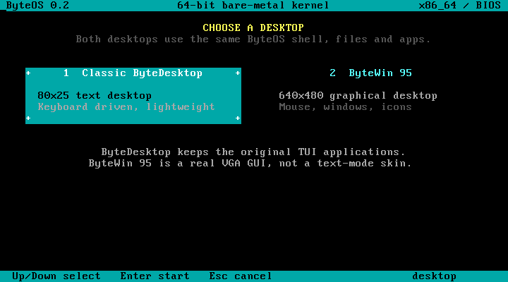

### ByteDesktop

ByteDesktop is a full-screen text-mode menu; there are no overlapping
windows. Use the arrow keys and Enter, the letter shortcuts, and **F10** or
**Esc** to return to the console.

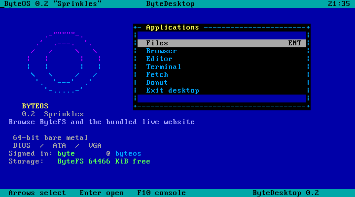

| App | What it does |
| --- | --- |
| **Files** | Lists ByteFS files on an installed disk (or the built-in ISO pages when live), with sizes and free space. Enter opens the browser, `F4` opens the editor. |
| **Browser** | Renders local HTML. `1`-`9` follow links, `u` opens the address bar, `Backspace` goes back, `r` reloads, `e` edits the current page, `Esc` returns. |
| **Editor** | HTML-only editor. Arrows move, `PgUp`/`PgDn` scroll, `Ctrl+S` or `F2` saves to ByteFS. |
| **Terminal** | The full ByteOS shell inside the desktop. `exit` returns to the menu. |
| **Fetch** | The system summary screen. |
| **Donut** | The spinning z-buffered ASCII torus. |

Keyboard shortcuts on the desktop menu: `f` Files, `b` Browser, `e` Editor,
`t` Terminal.

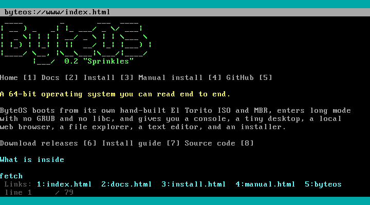

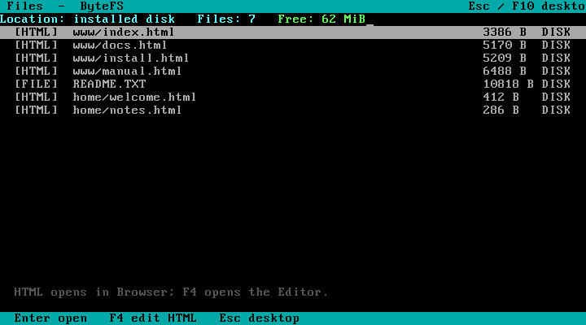

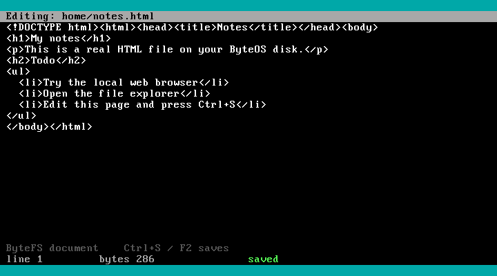

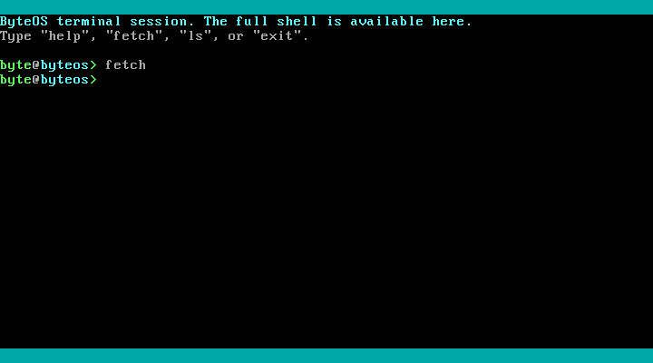

### ByteWin 95

ByteWin 95 is the second desktop: a genuine 640x480 VGA mode 12h GUI with 16
colours, not a text-mode skin. It saves the text-mode VGA registers, font,
palette, and screen before switching, so the shell is restored exactly when
you leave. Rendering uses a 16-pixel SSE2 planar converter and presents only
the rows that changed, which keeps the pointer and window dragging smooth.

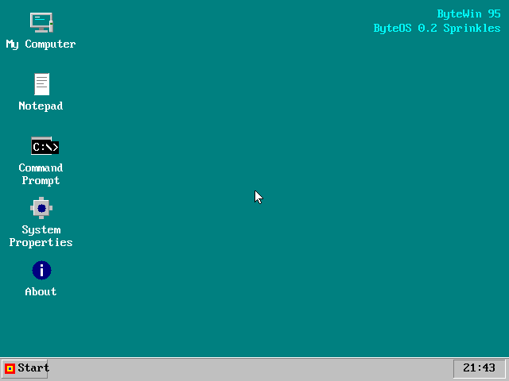

- **Mouse** - move the pointer, click taskbar buttons, double-click desktop
  icons or files, drag windows by their title bars, and use the minimize,
  maximize/restore and close boxes. Double-clicking a title bar toggles
  maximize too. Clicking the focused window's taskbar button minimizes it.
- **Start menu** - click Start or press **F10**. It opens My Computer,
  Notepad, Command Prompt, System Properties, About ByteWin 95, the original
  TUI Browser, HTML Editor, Terminal, Fetch (a native window), Fetch (TUI),
  Donut, and Screensaver, plus Restart and Shut Down.
- **Windows** - overlapping, draggable, focusable windows with an active
  title bar, a taskbar button each, and minimize, maximize and close boxes.
  Minimized windows stay on the taskbar and restore when clicked.
- **My Computer** - browses ByteFS on an installed disk, or the read-only
  built-in ISO pages when running live. Double-click folders and files.
- **Fetch** - a native ByteWin window with the large colour torus and live
  system data. The graphical `fetch` command opens it, and the original
  full-screen version is still available as Fetch (TUI).
- **Screensaver** - a colour starfield warp starts after 60 seconds without
  input, or on demand from Start > Screensaver. Any key or mouse movement
  returns to the desktop.
- **Command Prompt** - a graphical shell with `ls`/`dir [path]`, `cd`, `pwd`,
  `mkdir`, `rmdir`, `touch`, `rm`, `cat`, `lsblk`, `df`, `free`, `uname`,
  `date`, `uptime`, `hostname`, `echo`, `whoami`, `clear`, `exit`, `fetch`,
  `history`, and `help`. Up and Down recall previous commands.
- **TUI handoff** - Browser, HTML Editor, Terminal, Fetch (TUI), and Donut
  switch back to text mode, run the original app, then return to the GUI.

Keyboard shortcuts: **F10** Start menu, **F12** leave ByteWin 95, **Esc**
close the focused window, **Tab** cycle visible windows, arrow keys move
through icons and menus, and **Enter** launches. F12 and Shut Down return to
the ByteOS shell; Restart reboots the machine.

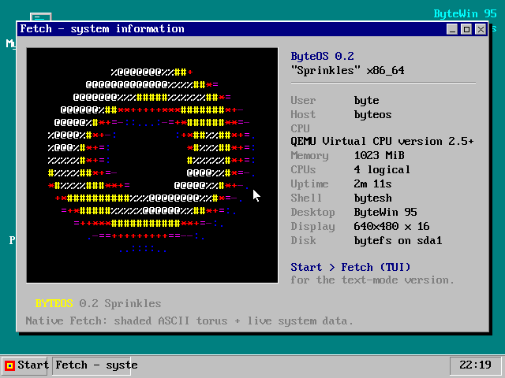

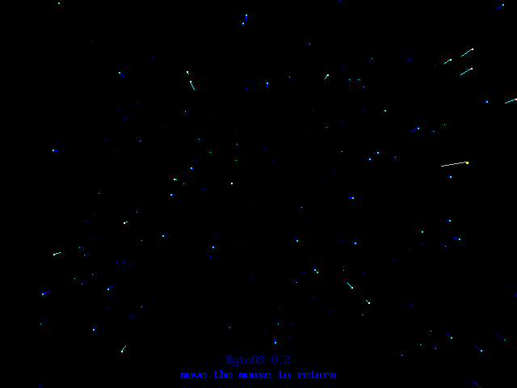

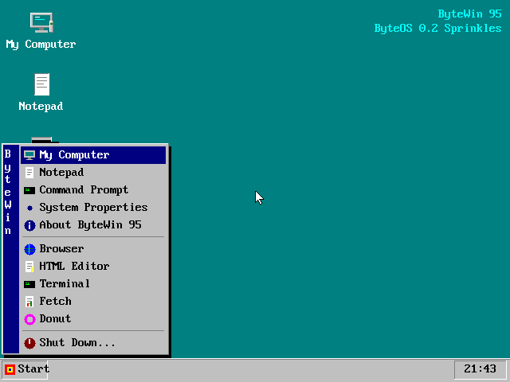

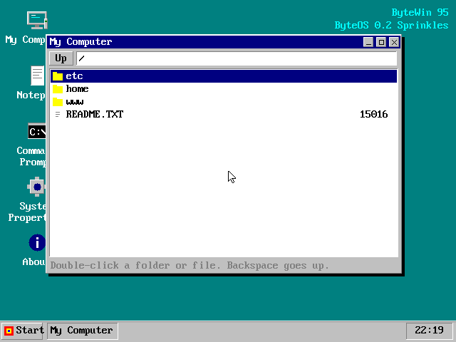

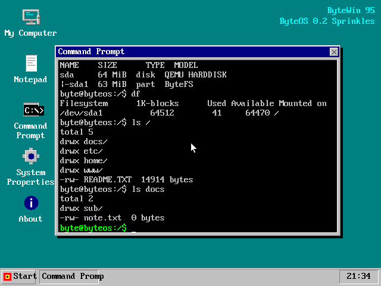

The text-mode browser is intentionally a small HTML subset renderer. It
understands headings, paragraphs, lists, links, horizontal rules, rudimentary
tables, and `<pre>` blocks. It does not run JavaScript or load CSS. External
`http://` and `https://` links show their address and a "no network" message
because ByteOS has no network stack.

## Shell commands

| Command | What it does |
| --- | --- |
| `help` / `?` | Command list |
| `fetch` | Fastfetch-style system summary |
| `specs` / `sysinfo` | CPUID, memory map, TSC, RTC, and build report |
| `memmap` / `e820` | Raw BIOS E820 memory map |
| `about` | Project background |
| `start-desktop` / `desktop` | Choose ByteDesktop or ByteWin 95 |
| `start-desktop classic` | Start the text-mode ByteDesktop directly |
| `start-desktop win95` | Start the graphical ByteWin 95 directly |
| `byte-install` | Guided installation to an ATA disk |
| `ls` / `dir [path]` | List ByteFS files and directories |
| `pwd` | Print the current directory |
| `cd [path]` | Change directory; no argument goes to `/home` |
| `mkdir <path>` | Create a directory |
| `rmdir <path>` | Remove an empty directory |
| `touch <path>` | Create an empty file |
| `rm <path>` | Delete a file |
| `cat <path>` | Print a ByteFS file |
| `lsblk` | List ATA disks and the mounted ByteFS partition |
| `df` | Show ByteFS space usage |
| `free` | Show memory usage |
| `uname [-a\|-r\|-m\|-n\|-s]` | System name and release |
| `date` | Read the RTC date and time |
| `uptime` | Time since boot |
| `hostname` | Show the hostname |
| `echo <text>` | Print text; expands `$USER`, `$HOME`, `$PWD`, `$HOSTNAME`, `$SHELL` |
| `whoami` | Current account |
| `su` | Switch to root |
| `passwd` | Change the current account password |
| `donut` | Spin the ASCII donut; any key returns |
| `logo` / `home` | Redraw the boot screen |
| `clear` / `cls` | Clear the screen |
| `version` | Version string |
| `reboot` | Warm reboot |

Commands are case-insensitive. `dir` is an alias for `ls`. The shell keeps a
virtual current directory over the flat ByteFS namespace: paths such as
`www/docs.html` and `home/notes.html` imply their parent directories, and
`mkdir` adds an explicit directory entry. Paths in `cat` and in the browser
are case-insensitive too.

## Build

Requirements:

- NASM (tested with 3.02)
- LLVM/Clang with `ld.lld` and `llvm-objcopy` (tested with 23.1.6)
- Python 3 (tested with 3.12)
- QEMU only for `run.ps1` (tested with 11.1.0)

On Windows:

```powershell
winget install NASM.NASM
winget install LLVM.LLVM
winget install Python.Python.3.12
winget install SoftwareFreedomConservancy.QEMU
```

Then:

```powershell
.\build.ps1
```

The build assembles the MBR and stage 2, embeds `website/` into the kernel,
compiles the kernel with Clang, links it with `ld.lld`, pads the boot image so
the kernel lands at physical `0x10000`, and writes the ISO with the project's
own ISO9660/El Torito writer. No external ISO tool is required.

## Project layout

```text
boot/boot.asm       16-bit BIOS loader, 32-bit trampoline, long-mode entry
boot/mbr.asm        MBR and stage-2 disk loader
kernel/core.c       entry point, VGA console, kprintf, memory/string helpers
kernel/platform.c   CPUID, E820, RTC/CMOS, PIT/TSC, PS/2 keyboard and mouse
kernel/ui.c         boot screen, reports, help/about, shell, desktop chooser, commands
kernel/ata.c        ATA PIO disk driver
kernel/bfs.c        ByteFS format, mount, read, write, directories
kernel/auth.c       accounts, login, su, passwd
kernel/install.c    byte-install wizard and disk writer
kernel/fetch.c      fetch system summary and TUI fetch screen
kernel/fetch_art.c  shared shaded torus ASCII art for TUI and GUI fetch
kernel/fetch_art.h  fetch art declarations
kernel/desktop.c    classic ByteDesktop, file explorer, terminal
kernel/win95.c      VGA mode 12h ByteWin 95 graphical desktop
kernel/font8x16.h   embedded 8x16 VGA font used by ByteWin 95
kernel/browser.c    local HTML browser
kernel/editor.c     HTML editor
kernel/donut.c      z-buffered spinning ASCII torus
website/            offline project website (embedded at build time)
screenshots/        screenshots used by this README
build.ps1           build everything and produce ByteOS.iso
run.ps1             boot the ISO in QEMU
```

## Boot path

1. BIOS finds the El Torito catalog (or the MBR) and loads the 512-byte boot
   sector at physical `0x7C00`.
2. Stage 2 enables A20, collects the E820 memory map, switches to VGA text
   mode 80x25, and identity-maps the first 1 GiB with 2 MiB pages.
3. It enables PAE, long mode, and SSE state saving, then jumps to the flat
   kernel at `0x10000` on a stack at `0x700000`.
4. The kernel zeroes `.bss`, detects the CPU, reads the memory map, calibrates
   the TSC with PIT channel 2, probes ATA disks, mounts ByteFS if the boot
   device is an installed disk, and starts the login or shell.

The ISO writer lays out the Primary Volume Descriptor, Boot Record Volume
Descriptor, terminator, boot catalog, boot image, root directory, path tables,
and the ISO copy of this README. SeaBIOS/QEMU is strict about the Boot Record
Volume Descriptor being at LBA 17 and the `EL TORITO SPECIFICATION` field
being zero-padded; the builder follows that layout.

## Limitations and next steps

ByteOS is still a small system, not a general-purpose OS:

- BIOS/CSM boot only; no UEFI.
- ATA PIO only; no AHCI, NVMe, or USB storage in the installer.
- No networking. External links in the browser show their address.
- No interrupts, scheduler, user mode, or virtual memory beyond the initial
  identity map. Input is polled.
- VGA only: text mode 80x25 and mode 12h at 640x480 with 16 colours. There is
  no VBE or higher-resolution framebuffer.
- ByteFS has 32 directory entries, a flat path namespace, virtual
  directories, and no permissions or journal.

Natural next steps are an IDT with timer and keyboard interrupts, a physical
page allocator, a heap, a richer filesystem, ATA DMA/AHCI, networking, and
eventually UEFI boot.

## Links

- Source: https://github.com/withdrawment/byteos
- Releases: https://github.com/withdrawment/byteos/releases
- Documentation: [`website/docs.html`](website/docs.html)
- Installation guide: [`website/install.html`](website/install.html)
- Manual installation: [`website/manual.html`](website/manual.html)
